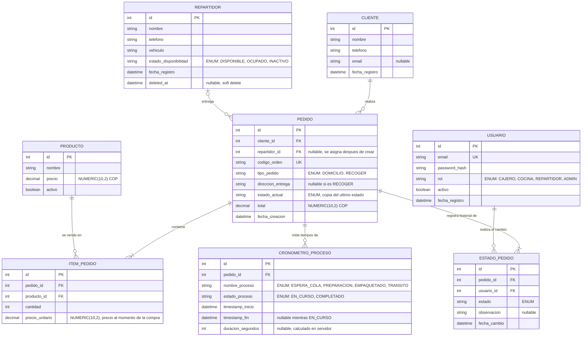

# ORIZEN Kitchen & Delivery Flow API


## Descripción del Proyecto

Esta API REST funciona como el motor principal para la gestión de estados, trazabilidad y medición de tiempos operativos en el restaurante ORIZEN. Su objetivo es orquestar el ciclo de vida completo de un pedido, desde que es recibido en caja hasta que el repartidor lo entrega en la puerta del cliente.

El sistema resuelve la opacidad y la ansiedad en el seguimiento de pedidos sustituyendo los tradicionales "tiempos estimados estáticos" por una trazabilidad en tiempo real. Esto se logra mediante el registro de cronómetros por cada proceso (espera en cola, preparación en wok, empaquetado y tránsito), permitiendo tanto al restaurante auditar su eficiencia como al cliente final conocer exactamente qué está pasando con su comida.

## Demo en línea

| Qué | Enlace |
|-----|--------|
| Frontend ([repo aparte](https://github.com/JuanR1207/orizen-frontend)) | _(se agrega cuando quede desplegado en Render)_ |
| API (documentación Scalar) | _(URL de Render)_`/scalar` |
| Salud de la API | _(URL de Render)_`/health` |

> Render (plan gratis) duerme la API tras 15 minutos sin uso. Si la primera petición tarda, es normal: espera a que `/health` responda.

### Usuarios de demo

Los crea el script `python -m app.seed`. La contraseña de los usuarios demo es la de `SEED_PASSWORD` (por defecto `orizen2026`); la del admin es la de `FIRST_ADMIN_PASSWORD` del `.env`.

| Rol | Email | Qué puede hacer |
|-----|-------|-----------------|
| ADMIN | `admin@orizen.com` | Todo: productos, repartidores, despacho y reportes |
| CAJERO | `cajero@orizen.com` | Registrar clientes, crear pedidos, entregar pedidos para recoger y cancelar |
| COCINA | `cocina@orizen.com` | Pasar pedidos a preparación y empaquetado (con cronómetros) |
| REPARTIDOR | `repartidor@orizen.com` | Marcar pedidos en tránsito y entregados |

## Cómo correr el proyecto

### Opción A: Docker (API + PostgreSQL)

```bash
cp .env.example .env          # y cambia SECRET_KEY y FIRST_ADMIN_PASSWORD
docker compose up --build     # API en http://localhost:8000/scalar
docker compose exec api python -m app.seed   # datos de demo (en otra terminal)
```

Las migraciones (`alembic upgrade head`) se aplican solas al arrancar el contenedor.

### Opción B: Sin Docker (SQLite o Neon)

```bash
python -m venv .venv
.venv\Scripts\activate            # Windows (en Linux/Mac: source .venv/bin/activate)
pip install -r requirements.txt -r requirements-dev.txt
alembic upgrade head
python -m app.seed
uvicorn app.main:app --reload
```

### Frontend

El frontend es un proyecto aparte que consume esta API: [JuanR1207/orizen-frontend](https://github.com/JuanR1207/orizen-frontend) (React + Vite). Para que el navegador pueda llamar la API, el dominio del frontend tiene que estar en `CORS_ORIGINS` del `.env` (en local ya vienen `http://localhost:5173` y `http://localhost:3000`).

### Pruebas

```bash
pytest -q
```

GitHub Actions corre las pruebas y las migraciones en cada PR hacia `develop` y `main`.

## Video de Presentación

- Enlace al video de presentación (máx. 5 minutos): [Ver video en YouTube](https://www.youtube.com/watch?v=SOTZqKKSSVw)

## Equipo de Desarrollo

| Nombre                  | Rol            | GitHub                     |
|-------------------------|----------------|----------------------------|
| Santiago Muñoz Estrada  | Líder / Tester | [@santme17](https://github.com/santme17)                       |
| Juan Jose Rendon Guzman | Backend        | [@JuanR1207](https://github.com/JuanR1207)                     |
| Steeven Grajales Flórez | Analista       | [@stevenflorez2304-oss](https://github.com/stevenflorez2304-oss) |
| Juan Jose Roldan Rivas  | Frontend       | [@majurivas0330-beep](https://github.com/majurivas0330-beep)   |

## Modelo de Datos

El sistema se compone de 8 entidades:

| Entidad              | Descripción |
|----------------------|-------------|
| `USUARIO`            | Cuenta del sistema con rol (cajero, cocina, repartidor, admin). Se usa para autenticación JWT y para registrar quién cambia cada estado. |
| `CLIENTE`            | Persona que realiza pedidos. Evita repetir nombre y teléfono en cada orden. |
| `REPARTIDOR`         | Domiciliario encargado de la entrega. Se asigna al pedido después de crearlo. Soporta borrado lógico. |
| `PRODUCTO`           | Plato o ítem del menú con su precio vigente. |
| `PEDIDO`             | Entidad central. Agrupa cliente, repartidor, modalidad de entrega, estado actual y total. |
| `ITEM_PEDIDO`        | Línea de un pedido: producto, cantidad y precio unitario al momento de la compra. |
| `ESTADO_PEDIDO`      | Historial de transiciones de estado de un pedido (solo se agregan registros, nunca se editan ni se borran). |
| `CRONOMETRO_PROCESO` | Marcas de tiempo de inicio y fin de cada etapa operativa, con la duración calculada por el servidor. |

### Diagrama Entidad-Relación



### Valores de los ENUM

| Campo                                 | Valores válidos |
|---------------------------------------|-----------------|
| `USUARIO.rol`                         | `CAJERO`, `COCINA`, `REPARTIDOR`, `ADMIN` |
| `REPARTIDOR.estado_disponibilidad`    | `DISPONIBLE`, `OCUPADO`, `INACTIVO` |
| `PEDIDO.tipo_pedido`                  | `DOMICILIO`, `RECOGER` |
| `PEDIDO.estado_actual` y `ESTADO_PEDIDO.estado` | `EN_COLA`, `EN_PREPARACION`, `EMPAQUETADO`, `EN_TRANSITO`, `ENTREGADO`, `CANCELADO` |
| `CRONOMETRO_PROCESO.nombre_proceso`   | `ESPERA_COLA`, `PREPARACION`, `EMPAQUETADO`, `TRANSITO` |
| `CRONOMETRO_PROCESO.estado_proceso`   | `EN_CURSO`, `COMPLETADO` |

### Reglas de Negocio

1. **Transiciones de estado válidas:** `EN_COLA` → `EN_PREPARACION` → `EMPAQUETADO` → `EN_TRANSITO` → `ENTREGADO`. Los pedidos de tipo `RECOGER` omiten `EN_TRANSITO`. `CANCELADO` solo es válido antes de `EN_TRANSITO`. Una transición inválida responde `409 Conflict`.
2. **Historial inmutable:** `ESTADO_PEDIDO` solo admite inserciones. No hay endpoints de edición ni borrado.
3. **Consistencia del estado actual:** al insertar un registro en `ESTADO_PEDIDO`, se actualiza `PEDIDO.estado_actual` en la misma transacción.
4. **Un solo cronómetro activo por proceso y pedido.** Se garantiza con un índice único parcial en PostgreSQL:
   ```sql
   CREATE UNIQUE INDEX uq_cronometro_activo
   ON cronometro_proceso (pedido_id, nombre_proceso)
   WHERE timestamp_fin IS NULL;
   ```
5. **Duración calculada en servidor:** `duracion_segundos` se calcula al cerrar el cronómetro como `timestamp_fin - timestamp_inicio`. Nunca se recibe del cliente.
6. **Total verificable:** `PEDIDO.total` debe ser igual a la suma de `cantidad * precio_unitario` de sus ítems. El servidor lo calcula; el cliente no lo envía.
7. **Precio congelado:** `ITEM_PEDIDO.precio_unitario` guarda el precio al momento de la compra, de modo que cambios posteriores en `PRODUCTO.precio` no alteran pedidos existentes.
8. **Asignación de repartidor:** solo pedidos `DOMICILIO` pueden tener repartidor, y solo repartidores con estado `DISPONIBLE`. Al asignarlo pasa a `OCUPADO`.
9. **Dirección obligatoria** para pedidos `DOMICILIO`; opcional para `RECOGER`.
10. **Borrado lógico:** los repartidores se marcan con `deleted_at`. Los pedidos no se borran; se cancelan mediante un estado.

## Documentación de Endpoints (API Design)

Endpoints diseñados bajo estándares RESTful. Base URL: `<URL de la API>/api/v1`. La documentación interactiva completa está en `/scalar`.

Todos los endpoints, excepto `POST /auth/login` y `GET /health`, requieren el header `Authorization: Bearer <token>`.

### 0. Autenticación

| Método | Endpoint       | Descripción                  | Payload (Body)                                  | Respuesta Esperada |
|--------|----------------|------------------------------|-------------------------------------------------|--------------------|
| POST   | `/auth/login`  | Iniciar sesión y obtener JWT | `{ "email": "...", "password": "..." }`         | 200 OK (token)     |
| GET    | `/auth/me`     | Usuario dueño del token      | N/A                                             | 200 OK (Object)    |

### 1. Recurso: Clientes (`/customers`)

| Método | Endpoint          | Descripción                | Payload (Body)                                    | Respuesta Esperada |
|--------|-------------------|----------------------------|---------------------------------------------------|--------------------|
| GET    | `/customers`      | Listar clientes            | N/A                                               | 200 OK (Array)     |
| GET    | `/customers/:id`  | Obtener un cliente         | N/A                                               | 200 OK (Object)    |
| POST   | `/customers`      | Registrar un cliente       | `{ "nombre": "...", "telefono": "..." }`          | 201 Created        |
| PATCH  | `/customers/:id`  | Actualizar datos           | `{ "telefono": "..." }`                           | 200 OK             |

### 2. Recurso: Productos (`/products`)

| Método | Endpoint          | Descripción                           | Payload (Body)                          | Respuesta Esperada |
|--------|-------------------|---------------------------------------|-----------------------------------------|--------------------|
| GET    | `/products`       | Listar productos                      | N/A                                     | 200 OK (Array)     |
| GET    | `/products/:id`   | Obtener un producto                   | N/A                                     | 200 OK (Object)    |
| POST   | `/products`       | Crear un producto                     | `{ "nombre": "...", "precio": 0.0 }`   | 201 Created        |
| PATCH  | `/products/:id`   | Actualizar producto                   | `{ "precio": 0.0, "activo": true }`    | 200 OK             |

### 3. Recurso: Repartidores (`/couriers`)

| Método | Endpoint          | Descripción                       | Payload (Body)                           | Respuesta Esperada |
|--------|-------------------|-----------------------------------|------------------------------------------|--------------------|
| GET    | `/couriers`       | Listar repartidores               | N/A                                      | 200 OK (Array)     |
| GET    | `/couriers/:id`   | Obtener un repartidor             | N/A                                      | 200 OK (Object)    |
| POST   | `/couriers`       | Registrar un repartidor           | `{ "nombre": "...", "vehiculo": "..." }` | 201 Created        |
| PATCH  | `/couriers/:id`   | Actualizar datos del repartidor   | `{ "estado_disponibilidad": "..." }`     | 200 OK             |
| DELETE | `/couriers/:id`   | Eliminar repartidor (soft delete) | N/A                                      | 204 No Content     |

### 4. Recurso: Pedidos (`/orders`)

| Método | Endpoint                | Descripción                                   | Payload (Body)                                                                                  | Respuesta Esperada |
|--------|-------------------------|-----------------------------------------------|-------------------------------------------------------------------------------------------------|--------------------|
| GET    | `/orders`               | Listar pedidos (filtros: estado, fecha, tipo) | N/A                                                                                             | 200 OK (Array)     |
| GET    | `/orders/:id`           | Obtener un pedido                             | N/A                                                                                             | 200 OK (Object)    |
| POST   | `/orders`               | Crear un pedido con sus ítems                 | `{ "cliente_id": "...", "tipo_pedido": "DOMICILIO", "direccion_entrega": "...", "items": [{ "producto_id": "...", "cantidad": 2 }] }` | 201 Created        |
| PATCH  | `/orders/:id`           | Actualizar datos del pedido                   | `{ "direccion_entrega": "..." }`                                                                | 200 OK             |
| PATCH  | `/orders/:id/courier`   | Asignar repartidor al pedido                  | `{ "repartidor_id": "..." }`                                                                    | 200 OK             |
| POST   | `/orders/:id/cancel`    | Cancelar el pedido                            | `{ "observacion": "..." }`                                                                      | 200 OK             |

El `total` y el `estado_actual` inicial (`EN_COLA`) los define el servidor al crear el pedido.

### 5. Endpoints Anidados de Pedido

| Método | Endpoint                       | Descripción                                          | Payload (Body)                                  | Respuesta Esperada |
|--------|--------------------------------|------------------------------------------------------|-------------------------------------------------|--------------------|
| GET    | `/orders/:id/items`            | Listar los ítems de un pedido                        | N/A                                             | 200 OK (Array)     |
| GET    | `/orders/:id/statuses`         | Historial de estados de un pedido                    | N/A                                             | 200 OK (Array)     |
| POST   | `/orders/:id/statuses`         | Registrar un nuevo estado (valida la transición)     | `{ "estado": "EN_PREPARACION", "observacion": "..." }` | 201 Created  |
| GET    | `/orders/:id/process-timers`   | Cronómetros asociados a un pedido                    | N/A                                             | 200 OK (Array)     |
| POST   | `/orders/:id/process-timers`   | Iniciar un cronómetro para un proceso del pedido     | `{ "nombre_proceso": "PREPARACION" }`           | 201 Created        |
| GET    | `/couriers/:id/orders`         | Pedidos asignados a un repartidor                    | N/A                                             | 200 OK (Array)     |

El historial de estados es append-only: no existen `PUT` ni `DELETE` sobre estados.

### 6. Recurso: Cronómetros de Proceso (`/process-timers`)

| Método | Endpoint                      | Descripción                                    | Payload (Body) | Respuesta Esperada |
|--------|-------------------------------|------------------------------------------------|----------------|--------------------|
| GET    | `/process-timers`             | Listar cronómetros (filtros: pedido, proceso)  | N/A            | 200 OK (Array)     |
| GET    | `/process-timers/:id`         | Obtener un cronómetro                          | N/A            | 200 OK (Object)    |
| PATCH  | `/process-timers/:id/stop`    | Detener el cronómetro y calcular la duración   | N/A            | 200 OK             |

### 7. Reportes (solo ADMIN) y tiempo real

| Método | Endpoint                    | Descripción                                             |
|--------|-----------------------------|---------------------------------------------------------|
| GET    | `/reports/daily-summary`    | Pedidos por estado, ventas y ticket promedio del día    |
| GET    | `/reports/process-times`    | Promedio, mínimo y máximo de cada proceso               |
| GET    | `/reports/top-products`     | Productos más vendidos del día                          |
| WS     | `/ws/kitchen?token=<jwt>`   | Pantalla de cocina: recibe `pedido_creado` y `estado_cambiado` |
| GET    | `/health` (sin `/api/v1`)   | La API y la base de datos responden                     |

### Códigos de Error Comunes

| Código | Uso |
|--------|-----|
| 400 Bad Request          | Cuerpo mal formado |
| 401 Unauthorized         | Token ausente o inválido |
| 403 Forbidden            | El rol del usuario no tiene permiso para la acción |
| 404 Not Found            | El recurso no existe |
| 409 Conflict             | Transición de estado inválida, cronómetro ya activo, repartidor no disponible |
| 422 Unprocessable Entity | Falla de validación (Pydantic) |

## Stack Tecnológico

| Componente     | Tecnología |
|----------------|------------|
| Lenguaje       | Python 3.12 |
| Framework      | FastAPI + SQLModel (async) |
| Base de datos  | PostgreSQL (Neon en producción, Docker en local) |
| Migraciones    | Alembic |
| Autenticación  | JWT (PyJWT) con roles |
| Documentación  | Scalar |
| Pruebas        | pytest + GitHub Actions |
| Contenedores   | Docker + Docker Compose |
| Frontend       | React + Vite, en su propio repo ([orizen-frontend](https://github.com/JuanR1207/orizen-frontend)) |
| Despliegue     | Render (API como servicio Docker) |

## Roadmap

- [x] Modelo de datos, migraciones con Alembic y reglas de negocio
- [x] Autenticación JWT con roles, paginación, reportes y cocina en tiempo real
- [x] Unidad de trabajo: una transacción por petición (commit o rollback en `get_session`)
- [x] Pruebas con pytest y CI en GitHub Actions
- [x] Docker y Docker Compose
- [x] Frontend en un repo aparte que consume la API (Caja, Cocina, Entregas y Admin)
- [ ] Despliegue en Render y paso a `main`
- [ ] Proyecto final: más reportes, mejoras del frontend y pruebas de carga

## Enlaces

- Repositorio de la API: [santme17/api-design-ORIZEN-Kitchen-Delivery-Flow-API](https://github.com/santme17/api-design-ORIZEN-Kitchen-Delivery-Flow-API)
- Repositorio del frontend: [JuanR1207/orizen-frontend](https://github.com/JuanR1207/orizen-frontend)
- Video de presentación: [Ver video en YouTube](https://www.youtube.com/watch?v=SOTZqKKSSVw)
- Organización del equipo: [Reemplazar con enlace a Trello/Jira](#)