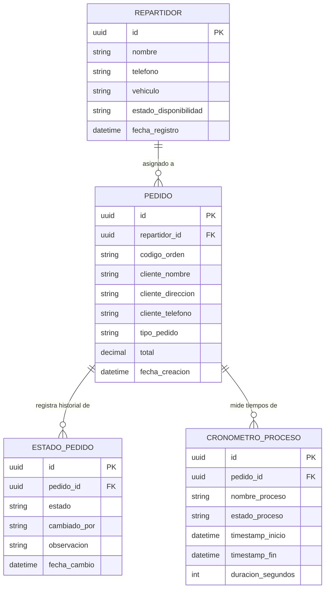

# 🚀 ORIZEN Kitchen & Delivery Flow API

## 📖 Descripción del Proyecto
Esta API REST funciona como el motor principal para la gestión de estados, trazabilidad y medición de tiempos operativos en el restaurante ORIZEN. Su objetivo es orquestar el ciclo de vida completo de un pedido, desde que es recibido en caja hasta que el repartidor lo entrega en la puerta del cliente.

El sistema resuelve la opacidad y la ansiedad en el seguimiento de pedidos sustituyendo los tradicionales "tiempos estimados estáticos" por una trazabilidad en tiempo real. Esto se logra mediante el registro de cronómetros por cada proceso (espera en cola, preparación en wok, empaquetado y tránsito), permitiendo tanto al restaurante auditar su eficiencia como al cliente final conocer exactamente qué está pasando con su comida.

## 🎬 Video de Presentación
(https://www.youtube.com/watch?v=SOTZqKKSSVw)

## 👥 Equipo de Desarrollo
| Nombre | Rol | GitHub |
|--------|-----|--------|
| Santiago Muñoz Estrada | Lider / Tester | [@santme17](#) |
| Juan Jose Rendon Guzman | Backend | [@JuanR1207](#) |
| Steeven Grajales florez | Analista | [@stevenflorez2304-oss](#) |
| Juan Jose Roldan Rivas | Frontend | [@majurivas0330-beep](#) |

## 🏗️ Modelo de Datos (Entidades)
El sistema se compone de las siguientes 4 entidades principales y sus relaciones:
1. **Pedido**: Entidad central que agrupa la información del cliente, los ítems solicitados y la modalidad de entrega.
2. **EstadoPedido**: Registra el historial de transiciones de estado por las que pasa una orden garantizando reglas válidas.
3. **CronometroProceso**: Almacena las marcas de tiempo de inicio y fin, calculando la duración exacta de cada etapa operativa.
4. **Repartidor**: Entidad que representa al domiciliario encargado de la entrega, vinculada al pedido durante la etapa de tránsito.

### Diagrama Entidad-Relación

## 🔌 Documentación de Endpoints (API Design)

A continuación se detallan los endpoints diseñados bajo estándares RESTful.
Base URL propuesta: `http://api.orizen.com/v1`

### 1. Recurso: Repartidores (ej. /couriers)

| Método | Endpoint | Descripción | Payload (Body) | Respuesta Esperada |
| --- | --- | --- | --- | --- |
| GET | `/couriers` | Listar todos los repartidores | N/A | 200 OK (Array) |
| GET | `/couriers/:id` | Obtener un repartidor | N/A | 200 OK (Object) |
| POST | `/couriers` | Registrar un repartidor | `{ "nombre": "...", "vehiculo": "..." }` | 201 Created |
| PUT | `/couriers/:id` | Actualizar datos del repartidor | `{ "estado_disponibilidad": "..." }` | 200 OK |
| DELETE | `/couriers/:id` | Eliminar repartidor (Soft Delete) | N/A | 204 No Content |

### 2. Recurso: Pedidos (ej. /orders)

| Método | Endpoint | Descripción | Payload (Body) | Respuesta Esperada |
| --- | --- | --- | --- | --- |
| GET | `/orders` | Listar todos los pedidos | N/A | 200 OK (Array) |
| GET | `/orders/:id` | Obtener un pedido específico | N/A | 200 OK (Object) |
| POST | `/orders` | Crear un nuevo pedido | `{ "cliente_nombre": "...", "total": 0.0 }` | 201 Created |
| PUT | `/orders/:id` | Actualizar datos del pedido | `{ "tipo_pedido": "..." }` | 200 OK |
| DELETE | `/orders/:id` | Cancelar/Eliminar pedido | N/A | 204 No Content |

### 3. Recurso: Estados de Pedido (ej. /order-statuses)

| Método | Endpoint | Descripción | Payload (Body) | Respuesta Esperada |
| --- | --- | --- | --- | --- |
| GET | `/order-statuses` | Listar historial general | N/A | 200 OK (Array) |
| GET | `/order-statuses/:id` | Obtener detalle de un estado | N/A | 200 OK (Object) |
| POST | `/order-statuses` | Registrar nuevo estado | `{ "estado": "...", "pedido_id": "..." }` | 201 Created |
| PUT | `/order-statuses/:id` | Modificar un registro de estado | `{ "observacion": "..." }` | 200 OK |
| DELETE | `/order-statuses/:id` | Eliminar registro (Solo Admin) | N/A | 204 No Content |

### 4. Recurso: Cronómetros de Proceso (ej. /process-timers)

| Método | Endpoint | Descripción | Payload (Body) | Respuesta Esperada |
| --- | --- | --- | --- | --- |
| GET | `/process-timers` | Listar todos los cronómetros | N/A | 200 OK (Array) |
| GET | `/process-timers/:id` | Obtener un cronómetro | N/A | 200 OK (Object) |
| POST | `/process-timers` | Iniciar un nuevo cronómetro | `{ "nombre_proceso": "...", "pedido_id": "..." }` | 201 Created |
| PUT | `/process-timers/:id` | Detener/Actualizar cronómetro | `{ "estado_proceso": "COMPLETADO" }` | 200 OK |
| DELETE | `/process-timers/:id` | Eliminar un cronómetro | N/A | 204 No Content |

### 5. Endpoints de Relación (Anidados)

*Endpoints que cruzan entidades.*

| Método | Endpoint | Descripción |
| --- | --- | --- |
| GET | `/orders/:id/statuses` | Obtener todo el historial de estados de una orden específica |
| GET | `/orders/:id/process-timers` | Obtener todos los cronómetros asociados a una orden |
| GET | `/couriers/:id/orders` | Listar todas las órdenes asignadas a un repartidor específico |

## 🛠️ Stack Tecnológico Propuesto

* **Lenguaje:** Python
* **Framework:** FastAPI
* **Base de Datos:** PostgreSQL
* **Autenticación:** JWT (JSON Web Tokens)

## 📅 Roadmap / Próximos Pasos

1. Configurar entorno de desarrollo local con Docker Compose.
2. Crear migraciones de base de datos basadas en el modelo ER.
3. Implementar controladores y validaciones Pydantic para los endpoints GET y POST.

## 🔗 Enlaces

* 🔗 **Repositorio GitHub:** (https://github.com/santme17/api-design-ORIZEN-Kitchen---Delivery-Flow-API)
* 🎬 **Video de Presentación:** (https://www.youtube.com/watch?v=SOTZqKKSSVw)
* 📋 **Organización del equipo:** [Reemplazar con enlace a Trello/Jira](#)
